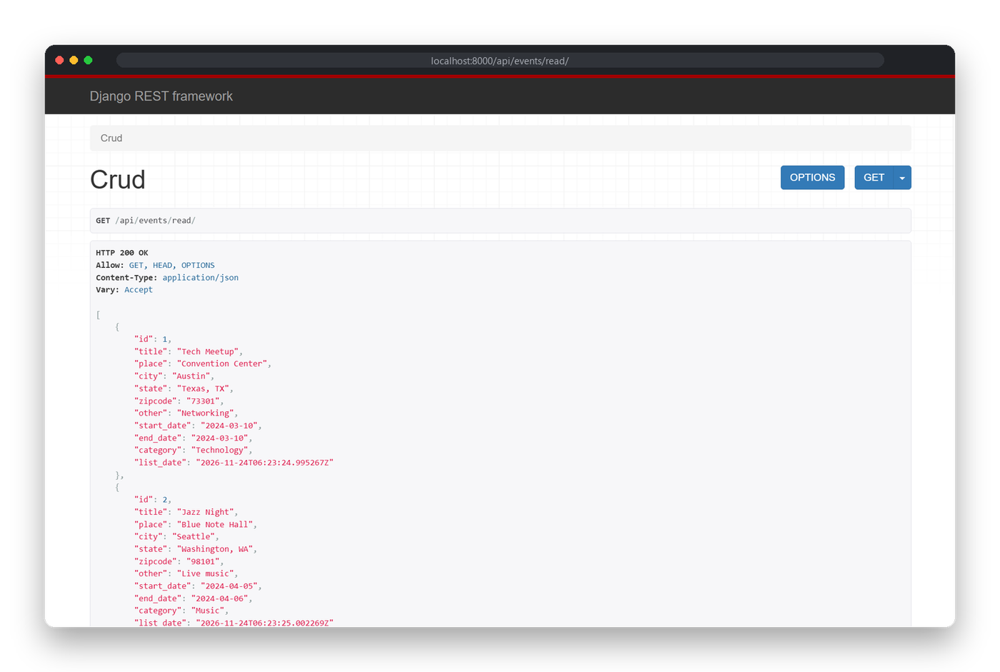

# CRUD_DRF 🔐

REST API built with **Django** and **Django REST Framework**, with **JWT authentication**
(SimpleJWT). It manages location records (title, place, city, US state and ZIP code) through a
full set of CRUD endpoints, plus an example of a protected view.




## Endpoints

| Method | Path | Description |
|---|---|---|
| `POST` | `/api/events/create/` | Create a record |
| `GET` | `/api/events/read/` | List records |
| `POST` | `/api/events/update/<id>` | Update a record |
| `DELETE` | `/api/events/delete/<id>` | Delete a record |
| `POST` | `/api/events/token/` | Get an access/refresh JWT pair |
| `POST` | `/api/events/token/refresh/` | Refresh the access token |
| `GET` | `/api/events/protegida/` | Example endpoint that requires a valid token |

## Tech stack

- Python · Django 4 · Django REST Framework
- `djangorestframework-simplejwt` for authentication
- Split settings per environment (`settings/base.py`, `dev.py`, `prod.py`)

## Getting started

```bash
python -m venv .venv
source .venv/bin/activate        # Windows: .venv\Scripts\activate
pip install -r requirements.txt
cp .env.example .env             # set DJANGO_SECRET_KEY
export DJANGO_SECRET_KEY=change-me
python manage.py migrate
python manage.py runserver
```

## License

[MIT](LICENSE) © Oscar Cuenca · [LinkedIn](https://www.linkedin.com/in/ocuenca-moreno/)
