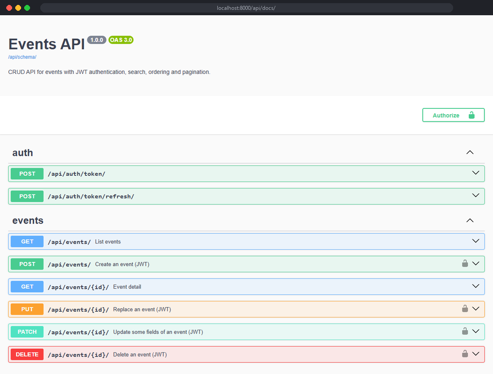
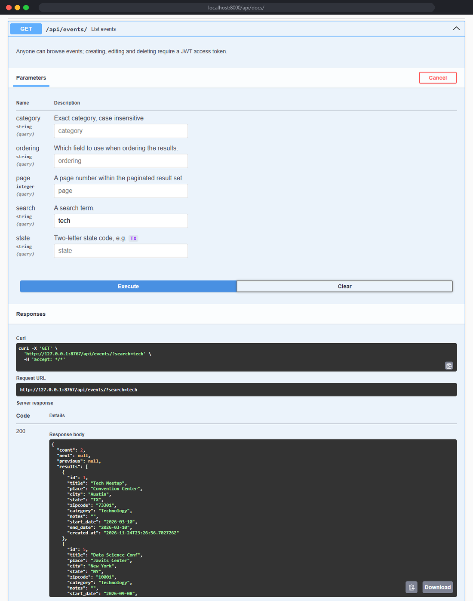

# CRUD_DRF 🔐

Events **REST API** built with **Django** and **Django REST Framework**: public browsing with search, filters,
ordering and pagination, and **JWT-protected** create, update and delete. The full contract is documented with
**OpenAPI 3** and explorable in Swagger UI.




## Features

- **`ModelViewSet` + router:** standard REST routes for the `Event` resource.
- **Permissions:** anyone can read; writing needs a JWT access token (`IsAuthenticatedOrReadOnly`).
- **Querying:** `?search=` across title, venue, city and category, `?state=` and `?category=` filters,
  `?ordering=` by date, title or city, and page-number pagination.
- **Validation:** US state codes, ZIP code format and an end date that cannot precede the start date.
- **Docs:** OpenAPI 3 schema with drf-spectacular, Swagger UI and ReDoc.
- **Admin** with list filters and search, plus a `seed_events` command with demo data.
- 8 API tests and a GitHub Actions workflow that also checks for missing migrations.

## API

| Method | Path | Auth | Description |
|---|---|---|---|
| `GET` | `/api/events/` | — | List events (search, filters, ordering, pagination) |
| `GET` | `/api/events/<id>/` | — | Event detail |
| `POST` | `/api/events/` | JWT | Create an event |
| `PUT` `PATCH` | `/api/events/<id>/` | JWT | Replace or partially update an event |
| `DELETE` | `/api/events/<id>/` | JWT | Delete an event |
| `POST` | `/api/auth/token/` | — | Get an access/refresh token pair |
| `POST` | `/api/auth/token/refresh/` | — | New access token from a refresh token |

Interactive docs at **`/api/docs/`** (Swagger UI) and **`/api/redoc/`**; raw schema at `/api/schema/`.

<details>
<summary>Example: searching events from Swagger UI</summary>



</details>

```bash
# Sign in, then create an event with the access token
TOKEN=$(curl -s -X POST localhost:8000/api/auth/token/ -d "username=demo&password=..." | jq -r .access)
curl -X POST localhost:8000/api/events/ -H "Authorization: Bearer $TOKEN" \
     -d "title=Jazz Night&place=Blue Note Hall&city=Seattle&state=WA&zipcode=98101" \
     -d "category=Music&start_date=2026-04-05&end_date=2026-04-05"
```

## Getting started

```bash
python -m venv .venv
source .venv/bin/activate            # Windows: .venv\Scripts\activate
pip install -r requirements.txt
export DJANGO_SECRET_KEY=change-me   # see .env.example
python manage.py migrate
python manage.py seed_events         # optional demo data
python manage.py createsuperuser     # user for JWT sign-in and the admin
python manage.py runserver
```

## Tests

```bash
python manage.py test
```

## Project structure

```
apps/crud_app/
├── models.py        # Event model and US state choices
├── serializer.py    # Validation rules
├── views.py         # EventViewSet: permissions, search, filters, ordering
├── urls.py          # Router
├── management/      # seed_events command
└── tests.py
Crud/urls.py         # API, JWT and documentation routes
settings/            # base, dev and prod settings
```

## License

[MIT](LICENSE) © Oscar Cuenca · [LinkedIn](https://www.linkedin.com/in/ocuenca-moreno/)
